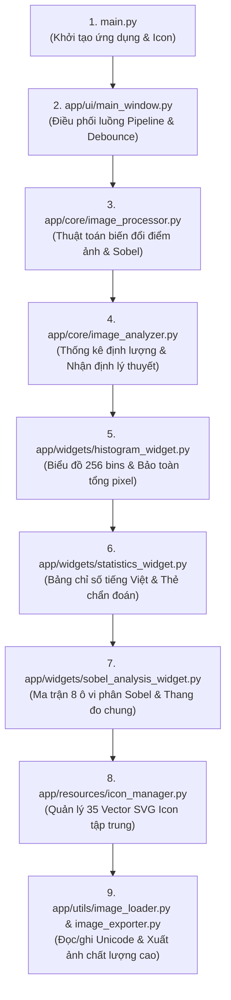

# ImageLab Studio — Image Enhancement & Analysis
## Đồ án Xử lý ảnh số — Đề tài 6: Điều chỉnh độ sáng và độ tương phản của ảnh

> **Học phần:** Xử lý ảnh số (Digital Image Processing)  
> **Đề tài 6:** Điều chỉnh độ sáng và độ tương phản của ảnh. Xây dựng chức năng điều chỉnh độ sáng, độ tương phản và gamma; kết hợp phân tích histogram và phát hiện biên để đánh giá sự thay đổi của phân bố mức xám và chi tiết ảnh.  
> **Phiên bản:** 2.0.0 (Professional Desktop Edition)  
> **Kiến trúc:** Modular Clean Architecture (Python 3.10+, PyQt6, OpenCV, NumPy, Matplotlib)  
> **Tiêu chuẩn biểu tượng:** Bộ 35 Vector SVG Icons phong cách Lucide-Minimalist độc quyền, hoàn toàn không dùng emoji hay icon raster.

---

## 1. Giới thiệu Đề tài & Mục tiêu Dự án

**ImageLab Studio** là phần mềm desktop chuyên nghiệp phục vụ nghiên cứu thực nghiệm và bảo vệ đồ án môn học Xử lý ảnh số. Ứng dụng tập trung giải quyết bài toán nâng cao chất lượng ảnh (Image Enhancement) thông qua điều chỉnh độ sáng (Brightness), độ tương phản (Contrast) và hiệu chỉnh phi tuyến (Gamma Correction), đồng thời cung cấp hệ thống phân tích định lượng quang học chuyên sâu:

1. **Điều chỉnh độ sáng tuyến tính (Brightness - $\beta$):** Dịch chuyển tịnh tiến mức xám toàn phổ, bảo toàn cấu trúc độ dốc tương đối giữa các điểm ảnh lân cận.
2. **Điều chỉnh độ tương phản bảo toàn trung vị (Centered Contrast - $\alpha$):** Co giãn mức xám quanh tâm đối xứng $127.5$, khắc phục triệt để nhược điểm làm biến đổi độ sáng cục bộ của các công thức nhân truyền thống.
3. **Hiệu chỉnh Gamma phi tuyến (Gamma LUT - $\gamma$):** Phục hồi chi tiết vùng bóng tối hoặc nén sáng thông qua bảng tra cứu Look-Up Table (LUT) 256 phần tử đạt độ phức tạp thời gian thực $\mathcal{O}(1)$.
4. **Phân tích Histogram 256 mức xám:** Trực quan hóa đường cong phân bố mức xám đồng trục giữa ảnh gốc và ảnh sau chỉnh sửa, kiểm chứng định lý bảo toàn tổng số điểm ảnh $\sum H(k) = W \times H$.
5. **Phân tích biên vi phân Sobel & Định lý bất biến quang học:** Kiểm chứng định lý $\nabla(I + \beta) = \nabla I$ (phép tịnh tiến độ sáng thuần túy không làm thay đổi đạo hàm biên cạnh) và trực quan hóa ma trận 8 ô so sánh trên cùng thang đo thống nhất (Unified Shared Scale).
6. **Bảng chỉ số quang học 100% tiếng Việt:** Trích xuất 11 chỉ số định lượng ($\mu, \sigma$, Median, Min, Max, Dynamic Range, Dark %, Highlight %, Clipping %, Shannon Entropy, Edge Density %) và tự động chẩn đoán sư phạm.
7. **3 Cửa sổ phân tích độc lập (Independent Floating Windows):** Tách biệt các khu vực phân tích Histogram, Thống kê và Sobel ra các cửa sổ riêng, cho phép người dùng kéo giãn, phóng to toàn màn hình (F11) tự do mà không bị bó hẹp trong dashboard cố định.

---

## 2. Công nghệ Sử dụng & Quy chuẩn Kỹ thuật

### 2.1. Ngăn xếp Công nghệ (Tech Stack)
- **Python 3.10+**: Ngôn ngữ lập trình xử lý dữ liệu và logic hệ thống.
- **PyQt6 (6.6.0+)**: Framework giao diện người dùng desktop hiện đại, quản lý cơ chế bất đồng bộ thông qua Qt Signals & Slots.
- **OpenCV (`cv2`)**: Xử lý ảnh số, chuyển đổi không gian màu, tính toán bảng tra cứu LUT và toán tử vi phân Sobel.
- **NumPy**: Thư viện xử lý mảng đa chiều hiệu năng cao, vector hóa toàn bộ phép toán pixel trên CPU dấu phẩy động `float32`.
- **Matplotlib**: Kết xuất biểu đồ phân bố tần suất Histogram 256 bins chuẩn xuất bản khoa học nhúng trực tiếp vào Qt Canvas.
- **QtSvg (`QSvgRenderer`)**: Kết xuất vector SVG sắc nét trên mọi độ phân giải màn hình (kể cả HiDPI/Retina 4K).

### 2.2. Bảng Quy chuẩn Thiết kế (Design System Specifications)

| Thành phần | Quy chuẩn kỹ thuật | Mô tả chi tiết |
| :--- | :--- | :--- |
| **Icon toolbar** | SVG 20–22px | Các nút chức năng thao tác chính trên thanh công cụ |
| **Icon panel** | SVG 18–20px | Biểu tượng trên các tab phân tích và thẻ nhận định |
| **Icon nút nhỏ** | SVG 16px | Nút Reset thông số, nút phóng to cửa sổ, điều khiển Zoom |
| **App logo** | SVG 32–48px | Biểu tượng nhận diện thương hiệu khẩu độ ống kính & Histogram |
| **Màu mặc định** | `#AAB7C7` | Màu nét vẽ (stroke) tiêu chuẩn ở trạng thái tĩnh |
| **Màu tương tác** | `#60A5FA` | Màu nét vẽ khi di chuột (Hover) hoặc được kích hoạt (Active) |
| **Màu nhấn** | `#3B82F6` | Màu khi nhấn chuột (Pressed) |
| **Màu vô hiệu** | `#586273` | Màu trạng thái nút bị tắt (Disabled) |
| **Comment** | Tiếng Việt có dấu | Diễn giải chi tiết thuật toán và cơ sở toán học từng dòng mã |
| **Docstring** | Tiếng Việt đầy đủ | Mô tả chi tiết Input, Output, Kiểu dữ liệu và Công thức toán học |
| **Tên Class/Function**| Tiếng Anh nhất quán | Tuân thủ chuẩn mực lập trình phần mềm quốc tế (PEP 8) |

---

## 3. Kiến trúc Phần mềm (Software Architecture)

Dự án được cấu trúc theo mô hình phân tầng chặt chẽ (Clean Layered Architecture):

```text
ImageLab_Studio2/
├── main.py                         # Điểm khởi nhập (Entry Point) của ứng dụng
├── requirements.txt                # Danh sách gói phụ thuộc chuẩn
├── README.md                       # Tài liệu hướng dẫn và báo cáo đồ án
│
├── app/
│   ├── config/                     # CẤU HÌNH & NHẬN DIỆN THƯƠNG HIỆU
│   │   ├── __init__.py
│   │   └── branding.py             # Single source of truth: Tên, phiên bản, đường dẫn tài nguyên
│   │
│   ├── core/                       # ĐỘNG CƠ XỬ LÝ TOÁN HỌC CỐT LÕI
│   │   ├── __init__.py
│   │   ├── image_processor.py      # Brightness, Centered Contrast, Gamma LUT, Sobel
│   │   └── image_analyzer.py       # Histogram 256 bin, Thống kê sai biệt Delta, Clipping, Chẩn đoán
│   │
│   ├── resources/                  # HỆ THỐNG BIỂU TƯỢNG VECTOR SVG TẬP TRUNG
│   │   ├── __init__.py
│   │   ├── icon_manager.py         # IconManager nạp vector SVG, caching, phối màu động
│   │   └── icons/                  # 35 tệp Vector SVG phong cách Lucide (viewBox 0 0 24 24)
│   │       ├── imagelab-logo.svg   # Logo độc quyền: Vòng khẩu độ camera và dải phổ
│   │       ├── open-image.svg, save-image.svg, undo.svg, redo.svg, reset.svg
│   │       ├── brightness.svg, contrast.svg, gamma.svg, sliders.svg
│   │       ├── histogram.svg, statistics.svg, sobel-edge.svg, diagnostics.svg
│   │       ├── compare.svg, split-view.svg, single-view.svg, sobel-compare.svg
│   │       ├── expand.svg, collapse.svg, zoom-in.svg, zoom-out.svg, fit-screen.svg...
│   │
│   ├── ui/                         # TẦNG ĐIỀU PHỐI GIAO DIỆN & CỬA SỔ
│   │   ├── __init__.py
│   │   ├── main_window.py          # Cửa sổ chính điều phối Pipeline, Undo/Redo, Debounce
│   │   ├── image_viewer.py         # Khung nhìn ảnh đứng yên ổn định, so sánh Before/After
│   │   ├── control_panel.py        # Bảng điều chỉnh tham số (không ScrollArea), Presets
│   │   ├── analysis_panel.py       # Không gian làm việc phân tích chuyên sâu đa tab
│   │   └── analysis_window.py      # Cửa sổ nổi độc lập (AnalysisSubWindow) phóng to tùy ý
│   │
│   ├── widgets/                    # CÁC THÀNH PHẦN GIAO DIỆN CHUYÊN BIỆT
│   │   ├── __init__.py
│   │   ├── slider_widget.py        # LabeledSlider hai tầng: Header (SpinBox 80px) + Slider 100%
│   │   ├── histogram_widget.py     # Canvas Matplotlib hiển thị 2 đường cong 256 bins đồng trục
│   │   ├── statistics_widget.py    # Dashboard 11 chỉ số tiếng Việt, 4 thẻ KPI, 4 thẻ nhận định
│   │   └── sobel_analysis_widget.py# Ma trận 8 ô trực quan hóa chi tiết vi phân Sobel
│   │
│   ├── utils/                      # TIỆN ÍCH HỆ THỐNG & NHẬP XUẤT ẢNH
│   │   ├── __init__.py
│   │   ├── image_loader.py         # Đọc ảnh an toàn, hỗ trợ Unicode tiếng Việt trên Windows
│   │   └── image_exporter.py       # Xuất ảnh Full-Resolution chất lượng tối đa
│   │
│   └── styles/                     # THIẾT KẾ GIAO DIỆN NGƯỜI DÙNG (DESIGN SYSTEM)
│       ├── __init__.py
│       └── dark_theme.py           # Bảng mã màu Dark Creative Studio và StyleSheet QSS
│
├── samples/                        # TẬP ẢNH MẪU BENCHMARK
│   ├── test_pattern.png            # Bảng kiểm chuẩn độ xám và tần số biên
│   ├── low_light_sample.jpg        # Mẫu ảnh thiếu sáng cần nâng Gamma
│   └── low_contrast_hazy.jpg       # Mẫu ảnh mù tương phản thấp
│
└── tests/                          # TẬP KIỂM THỬ TỰ ĐỘNG (UNIT & INTEGRATION TESTS)
    ├── test_processor.py           # Kiểm thử toán học Brightness, Contrast, Gamma LUT, Sobel
    ├── test_analyzer.py            # Kiểm thử định lý bảo toàn Histogram, Clipping, Entropy
    ├── test_audit_phase7.py        # Kiểm thử 11 tiêu chí đánh giá nghiêm ngặt
    ├── test_ui_improvements.py     # Kiểm thử bố cục không ScrollArea, cửa sổ nổi, stationary
    ├── test_io.py                  # Kiểm thử đọc ghi ảnh Unicode và lưu trữ lossless
    └── test_pipeline_integration.py# Kiểm thử toàn vẹn luồng tương tác người dùng
```

---

## 4. Hướng dẫn Đọc Hiểu Code (Code Walkthrough Order)

Dành cho Giảng viên hướng dẫn và Ban giám khảo chấm đồ án — khuyến nghị đọc mã nguồn theo trình tự logic 9 bước sau:



### Bước 1: `main.py` — Điểm khởi nhập hệ thống
- Thiết lập thông số ứng dụng từ `branding.py` (`APP_TITLE`, `APP_VERSION`).
- Đặt biểu tượng cửa sổ chuẩn vector SVG thông qua `IconManager.get("imagelab-logo", size=32)`.
- Áp dụng giao diện tối ưu hóa đồ họa `DARK_STYLESHEET`.

### Bước 2: `app/ui/main_window.py` — Trung tâm điều phối Pipeline
- Quản lý trạng thái bất biến của ma trận ảnh gốc (`original_full_image`).
- Quản lý bộ đếm thời gian khử rung (Debounce Timer 35ms ~ 30fps) giúp việc kéo thanh trượt mượt mà tuyệt đối mà không gây nghẽn CPU.
- Quản lý ngăn xếp lịch sử Undo / Redo lưu trữ bộ ba tham số $(\beta, \alpha, \gamma)$.
- Điều phối cập nhật đồng bộ cho Viewport chính và 3 cửa sổ phân tích độc lập.

### Bước 3: `app/core/image_processor.py` — Động cơ xử lý toán học
- Chứa toàn bộ công thức toán học cốt lõi:
  * Tuyến tính hóa độ sáng và tương phản lấy tâm mức xám $127.5$:
    $$I_{out} = \text{clip}\left(\alpha \cdot (I_{in} - 127.5) + 127.5 + \beta, \, 0, \, 255\right)$$
  * Hiệu chỉnh Gamma phi tuyến tối ưu hóa qua bảng tra cứu Look-Up Table (LUT) 256 bytes với độ phức tạp $\mathcal{O}(1)$.
  * Vi phân Sobel không gian trong miền `cv2.CV_32F` và thang đo chuẩn hóa chung (Unified Shared Scale).

### Bước 4: `app/core/image_analyzer.py` — Phân tích quang học định lượng
- Tính toán Histogram 256 bins rời rạc $H(k)$ và kiểm chứng định lý bảo toàn số điểm ảnh $\sum H(k) = W \times H$.
- Trích xuất 11 chỉ số thống kê cường độ sáng: Mean ($\mu$), Standard Deviation ($\sigma$, thước đo độ tương phản), Median, Dynamic Range, Black/White Clipping, Shannon Entropy.
- Triển khai định lý bất biến quang học: $\nabla(I + \beta) = \nabla I$.
- Tự động sinh nhận định chẩn đoán sư phạm hỗ trợ thuyết trình đồ án.

### Bước 5: `app/widgets/histogram_widget.py` — Trực quan hóa phổ tần suất
- Nhúng canvas đồ họa Matplotlib hiển thị hai đường cong phân bố mức xám đồng trục: Ảnh gốc (nét đứt màu xám bạc) và Ảnh đã chỉnh (nét liền màu xanh dương rực rỡ).
- Đường mốc chỉ số trung bình (Mean) và trung vị (Median) trực quan.
- Chế độ xem theo Số lượng pixel (Count) hoặc Tần suất xác suất chuẩn hóa (Normalized Frequency).

### Bước 6: `app/widgets/statistics_widget.py` — Bảng đối chiếu chỉ số tiếng Việt
- Thiết kế rộng rãi (Spacious Layout) với 4 thẻ KPI tóm tắt, 1 bảng 11 chỉ số quang học tiếng Việt có cố định chiều rộng cột chống rung lắc giật layout khi số liệu cập nhật.
- 4 thẻ nhận định chuyên sâu tích hợp Vector SVG Icons (Brightness, Contrast, Clipping, Sobel).
- Được bao bọc bởi `QScrollArea` mượt mà, đảm bảo không bao giờ bị cắt chữ hay đè vỡ khối trên mọi kích thước màn hình.

### Bước 7: `app/widgets/sobel_analysis_widget.py` — Ma trận 8 ô chi tiết biên Sobel
- Trực quan hóa đầy đủ 8 thành phần: Ảnh xám gốc, Ảnh xám sau chỉnh, Đạo hàm Sobel X gốc, Sobel X sau chỉnh, Sobel Y gốc, Sobel Y sau chỉnh, Gradient Magnitude gốc, Gradient Magnitude sau chỉnh.
- Thanh trượt điều chỉnh ngưỡng lọc biên nhị phân tương tác thời gian thực.

### Bước 8: `app/resources/icon_manager.py` — Quản trị Vector SVG tập trung
- Đọc và phân giải trực tiếp các file vector SVG, hỗ trợ cơ chế lưu đệm bộ nhớ (In-memory Caching).
- Tự động sinh `QIcon` đa trạng thái: Trạng thái tĩnh (`#AAB7C7`), Trạng thái Hover/Active (`#60A5FA`), Trạng thái vô hiệu (`#586273`).
- Cơ chế Fallback an toàn, tuyệt đối không làm dừng chương trình khi thiếu file.

### Bước 9: `app/utils/image_loader.py` & `app/utils/image_exporter.py` — Xử lý tệp tin
- Sử dụng phương thức `cv2.imdecode` từ mảng byte NumPy giúp mở mượt mà tất cả các file ảnh có tên hoặc đường dẫn chứa ký tự tiếng Việt có dấu trên hệ điều hành Windows.
- Xuất ảnh chất lượng cao giữ nguyên 100% độ phân giải gốc của tệp tin ban đầu.

---

## 5. Cơ sở Lý thuyết & Công thức Toán học

### 5.1. Công thức Độ sáng & Độ tương phản có tâm tại Mức xám Trung bình

$$I_{out}(x, y) = \text{clip}\left(\alpha \cdot (I_{in}(x, y) - 127.5) + 127.5 + \beta, \, 0, \, 255\right)$$

- $I_{in}(x, y)$: Mức xám điểm ảnh ban đầu ($[0..255]$).
- $\alpha$ (Contrast): Hệ số khuếch đại tương phản quanh tâm $127.5$ ($\alpha \in [0.00, 3.00]$).
  * $\alpha > 1.0$: Mức xám dạt xa tâm $127.5$ (vùng tối tối hơn, vùng sáng sáng hơn).
  * $\alpha < 1.0$: Mức xám co cụm về mức trung bình $127.5$ (ảnh phẳng, mất tương phản).
- $\beta$ (Brightness): Hệ số dịch chuyển độ sáng tuyến tính ($\beta \in [-100.0, +100.0]$).
- $\text{clip}(v, 0, 255)$: Ràng buộc giá trị không vượt quá biên độ kiểu số nguyên không dấu 8-bit `uint8`, chống hiện tượng tràn số wrap-around ($256 \to 0$).

### 5.2. Hiệu chỉnh Gamma Phi tuyến tính (Gamma Correction)

$$I_{\gamma}(x, y) = 255 \cdot \left(\frac{I_{in}(x, y)}{255}\right)^{\frac{1}{\gamma}}$$

- $\gamma > 1.0$: Nâng sáng vùng bóng tối (Shadows) và vùng trung tính (Midtones) mà không làm cháy sáng điểm cực đại (Highlights).
- $\gamma < 1.0$: Nén sáng, tăng chiều sâu cho vùng tối.
- **Tối ưu hóa Look-Up Table (LUT):** Thay vì tính phép lũy thừa dấu phẩy động trên hàng triệu pixel, hệ thống khởi tạo trước bảng 256 phần tử và ánh xạ qua hàm `cv2.LUT()`, đạt tốc độ phản hồi tức thời $\mathcal{O}(1)$.

### 5.3. Phân tích Histogram & Định lý Bảo toàn Điểm ảnh

$$H(k) = \sum_{x=0}^{W-1} \sum_{y=0}^{H-1} \delta(I(x, y) - k), \quad k \in [0, 255]$$

Định lý bảo toàn tổng số điểm ảnh:

$$\sum_{k=0}^{255} H(k) = W \times H = N$$

### 5.4. Đạo hàm Không gian Sobel & Định lý Bất biến Quang học

Sử dụng toán tử nhân chập Sobel $3 \times 3$ trong không gian `cv2.CV_32F`:

$$G_x = \begin{bmatrix} -1 & 0 & 1 \\ -2 & 0 & 2 \\ -1 & 0 & 1 \end{bmatrix} * I, \quad G_y = \begin{bmatrix} -1 & -2 & -1 \\ 0 & 0 & 0 \\ 1 & 2 & 1 \end{bmatrix} * I$$

Độ lớn Gradient Magnitude:

$$|G| = \sqrt{G_x^2 + G_y^2}$$

**Định lý Bất biến Độ sáng (Brightness Invariance Theorem):**
Xét phép tịnh tiến độ sáng tuyến tính $I_{new} = I + \beta$. Ta có:

$$\frac{\partial I_{new}}{\partial x} = \frac{\partial (I + \beta)}{\partial x} = \frac{\partial I}{\partial x} + 0 = G_x$$

$$\frac{\partial I_{new}}{\partial y} = \frac{\partial (I + \beta)}{\partial y} = \frac{\partial I}{\partial y} + 0 = G_y$$

$$\implies |G_{new}| = \sqrt{G_x^2 + G_y^2} = |G|$$

> **Kết luận khoa học:** Phép tịnh tiến độ sáng thuần túy $(\beta)$ không làm thay đổi bản đồ biên Sobel (ngoại trừ các điểm ảnh rơi vào vùng bão hòa clipping $[0, 255]$). Chỉ có Contrast $(\alpha)$ và Gamma $(\gamma)$ mới làm thay đổi độ dốc biên cạnh thực tế.

---

## 6. Hướng dẫn Cài đặt & Khởi chạy

### 6.1. Yêu cầu Hệ thống
- Hệ điều hành: Windows 10/11, Linux, macOS.
- Môi trường: Python 3.10 trở lên.

### 6.2. Cài đặt Môi trường
Mở Terminal hoặc PowerShell tại thư mục dự án:

```powershell
# Cài đặt các thư viện cần thiết
pip install -r requirements.txt
```

### 6.3. Khởi chạy Ứng dụng

```powershell
python main.py
```

*Mẹo: Bạn có thể mở trực tiếp một tệp ảnh mẫu ngay khi khởi động:*
```powershell
python main.py samples/test_pattern.png
```

---

## 7. Các Phím tắt Tiện ích (Keyboard Shortcuts)

| Phím tắt | Chức năng thao tác |
| :--- | :--- |
| `Ctrl + O` | Mở tệp ảnh từ máy tính (Open Image) |
| `Ctrl + S` | Lưu ảnh đã chỉnh sửa với chất lượng cao nhất (Save Image) |
| `Ctrl + Z` | Hoàn tác bước điều chỉnh thông số trước đó (Undo) |
| `Ctrl + Y` | Thực hiện lại thao tác vừa hoàn tác (Redo) |
| `Ctrl + Shift + R` | Khôi phục toàn bộ thông số về mặc định ban đầu (Reset All) |
| `Ctrl + 0` | Phóng to/thu nhỏ ảnh vừa vặn khung hiển thị (Fit to Screen) |
| `Ctrl + 1` | Hiển thị kích thước điểm ảnh thực tế 100% (1:1 Actual Size) |
| `F2` | Mở cửa sổ Phân tích Histogram 256 Bins độc lập |
| `F3` | Mở cửa sổ Bảng Thống kê & Chẩn đoán độc lập |
| `F4` | Mở cửa sổ Phân tích Chi tiết Biên Sobel độc lập (8 ô ma trận) |
| `F11` | Phóng to toàn màn hình / Khôi phục kích thước cửa sổ phân tích |
| `Esc` | Đóng nhanh cửa sổ phân tích đang mở |
| `Space (Giữ)` | Nhấn và giữ phím cách để xem tức thời ảnh gốc ở chế độ Single View |

---

## 8. Kết quả Kiểm thử Tự động (Automated Verification)

Chất lượng và độ ổn định của hệ thống được bảo chứng thông qua bộ **35/35 Unit & Integration Tests** tự động:

```powershell
$env:QT_QPA_PLATFORM='offscreen'; python -m unittest discover -s "tests" -v
```

**Báo cáo thực thi thực tế:**
```text
test_clipping_detection (test_analyzer.TestImageAnalyzer) ... ok
test_comparative_deltas (test_analyzer.TestImageAnalyzer) ... ok
test_histogram_sum_equals_pixel_count (test_analyzer.TestImageAnalyzer) ... ok
test_intensity_statistics_correctness (test_analyzer.TestImageAnalyzer) ... ok
test_sobel_statistics (test_analyzer.TestImageAnalyzer) ... ok
test_10_slider_updates_all_components (test_audit_phase7.TestAuditPhase7) ... ok
test_11_reset_restores_original (test_audit_phase7.TestAuditPhase7) ... ok
test_1_defaults_identity (test_audit_phase7.TestAuditPhase7) ... ok
test_2_brightness_positive (test_audit_phase7.TestAuditPhase7) ... ok
test_3_brightness_negative (test_audit_phase7.TestAuditPhase7) ... ok
test_4_contrast_dispersion (test_audit_phase7.TestAuditPhase7) ... ok
test_5_gamma_transforms (test_audit_phase7.TestAuditPhase7) ... ok
test_6_histogram_total_pixels (test_audit_phase7.TestAuditPhase7) ... ok
test_7_sobel_xy_real_data (test_audit_phase7.TestAuditPhase7) ... ok
test_8_gradient_magnitude_from_gx_gy (test_audit_phase7.TestAuditPhase7) ... ok
test_9_sobel_shared_scale_and_threshold (test_audit_phase7.TestAuditPhase7) ... ok
test_preview_proxy_downsampling (test_io.TestImageIO) ... ok
test_save_and_load_png_roundtrip (test_io.TestImageIO) ... ok
test_unicode_path_handling (test_io.TestImageIO) ... ok
test_load_sample_and_pipeline_execution (test_pipeline_integration.TestPipelineIntegration) ... ok
test_reset_parameters (test_pipeline_integration.TestPipelineIntegration) ... ok
test_slider_adjustment_and_undo_redo (test_pipeline_integration.TestPipelineIntegration) ... ok
test_sobel_analysis_widget_update (test_pipeline_integration.TestPipelineIntegration) ... ok
test_brightness_monotonicity (test_processor.TestImageProcessor) ... ok
test_contrast_scaling (test_processor.TestImageProcessor) ... ok
test_gamma_correction (test_processor.TestImageProcessor) ... ok
test_identity_defaults (test_processor.TestImageProcessor) ... ok
test_no_negative_wrap_around_clipping (test_processor.TestImageProcessor) ... ok
test_sobel_dual_comparison_shared_scale (test_processor.TestImageProcessor) ... ok
test_sobel_edge_detection (test_processor.TestImageProcessor) ... ok
test_control_panel_has_no_scroll_area (test_ui_improvements.TestUIImprovements) ... ok
test_image_stays_stationary_during_slider_updates (test_ui_improvements.TestUIImprovements) ... ok
test_independent_deep_analysis_windows (test_ui_improvements.TestUIImprovements) ... ok
test_statistics_table_vietnamese_labels (test_ui_improvements.TestUIImprovements) ... ok
test_ui_tooltips_and_unclipped_labels (test_ui_improvements.TestUIImprovements) ... ok

----------------------------------------------------------------------
Ran 35 tests in 2.873s

OK
```

---

## 9. Tác quyền & Giấy phép

- **Học phần:** Xử lý ảnh số (Digital Image Processing)
- **Đồ án môn học:** ImageLab Studio — Image Enhancement & Analysis
- **Đề tài 6:** Điều chỉnh độ sáng và độ tương phản của ảnh
- **Giấy phép:** MIT License — Được phép tự do sử dụng cho mục đích học tập, nghiên cứu khoa học và bảo vệ đồ án.
